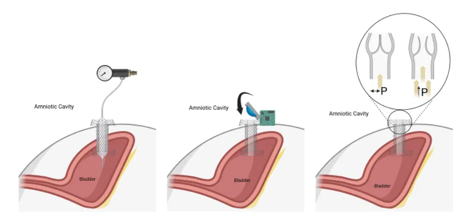
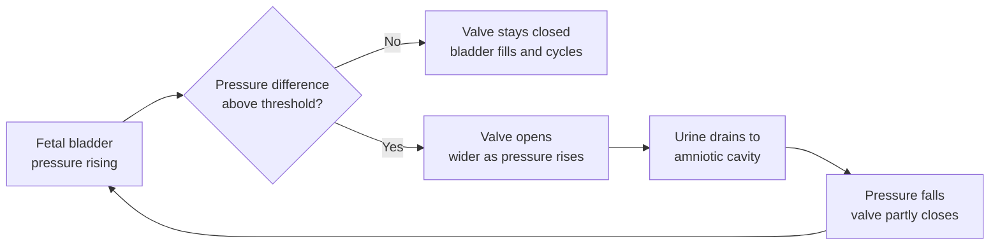

# Pressure-Dependent Fetal Vesicoamniotic Shunt (FLUTO)

[Back to portfolio](../README.md)

**Sohan Sai Jampala** | Design lead | Purdue University, BME 69500PD (course design project) | Fall 2025

A concept design for a fetal bladder shunt that drains urine only when bladder pressure passes a threshold. The goal is steadier bladder decompression than today's open shunts, with less clogging, migration and over-drainage. The project went from clinical need, through user needs gathered from maternal-fetal medicine surgeons, to concept selection and a staged evaluation plan.

---

## Clinical need

Fetal lower urinary tract obstruction (FLUTO), most often caused by posterior urethral valves, blocks urine flow out of the fetal bladder. Pressure backs up into the kidneys (hydronephrosis, renal dysplasia). Because fetal urine is the main source of amniotic fluid in mid-gestation, low fluid (oligohydramnios) also stunts lung development (pulmonary hypoplasia).

- Rare (a few per 10,000 pregnancies) but often fatal or life-limiting without treatment.
- Decisions usually fall in a narrow 18 to 24 week window.
- Survivors may face chronic kidney disease, dialysis or transplant.

## Current standard of care and its gaps

| Option | What it does | Main limitations |
|---|---|---|
| Expectant management | Monitor, treat after birth | Kidney and lung damage can progress in utero |
| Vesicoamniotic shunting (VAS) | Catheter drains the bladder into the amniotic cavity | Migration or dislodgement (40 to 80% in current designs), clogging, kinking, uncontrolled drainage |
| Fetal cystoscopy and valve ablation | Treats the obstruction directly | Technically demanding, limited availability, procedure risk |

---

## User needs (from conversations with maternal-fetal medicine surgeons)

| ID | User need | Why it matters |
|---|---|---|
| UN-1 | **Kink resistant** | The lumen must stay open under external forces so drainage continues |
| UN-2 | **Secure** | Fetal movement must not pull the shunt out of position |
| UN-3 | **Back-pressure attenuating** | Some bladder pressure supports healthy bladder and urinary tract development |
| DC-1 | **Compatible with the current VAS technique** (design constraint) | Clinicians can adopt it without learning a new procedure |

## Concepts compared

| Concept | How it works | Strength | Concern |
|---|---|---|---|
| A. One-way valve (iteration on the Vortex shunt) | Opens above a set bladder-to-amniotic pressure difference | Opening pressure can be verified; allows natural bladder filling | Fixed threshold |
| B. Balloon-controlled occlusion | Indwelling balloon blocks the lumen; clinician sets inflation | Manual control; familiar Seldinger technique | Needs clinician intervention |
| C. MEMS-controlled valve | Sensor plus micro-valve regulates flow by set parameters | Tightest control in theory | Power, complexity, cost, reliability |
| **Selected: passive pressure-dependent valve** | Valve opening widens as bladder pressure rises and narrows as it falls | Self-regulating, no power, same delivery as VAS | Threshold drift, valve durability |

*Concept sketches (team figure, made in BioRender). Left: balloon-controlled occlusion, with the clinician setting balloon pressure. Middle: MEMS sensor-controlled valve. Right: passive valve that opens wider as bladder pressure rises.*

---

## Selected design

| Element | Design intent |
|---|---|
| Catheter | Flexible small-bore catheter, outer diameter similar to current VAS devices; nitinol or polymer coil keeps the lumen open (UN-1) |
| Anchoring | Basket-style fixation at the bladder and amniotic ends, deployed after insertion (UN-2) |
| Valve segment | Short elastomeric diaphragm valve; opens only above the set pressure difference and widens with pressure (UN-3) |
| Delivery | Ultrasound-guided percutaneous VAS technique, unchanged shaft diameter (DC-1) |
| Manufacturing | Medical-grade silicone or polyurethane catheter; molded or laser-cut micro-valve, similar to pressure-activated valves in IV and drug delivery sets; materials compatible with standard sterilization |

---

## Evaluation plan (staged)

| Stage | What is checked | Measures |
|---|---|---|
| 1. Pressure response | Valve opens at the intended threshold and keeps responding through gestation | Intravesical and amniotic pressure before and after placement |
| 2. Stability | Shunt stays in place under fetal movement and uterine forces | Serial ultrasound for position, migration and kinking |
| 3. Amniotic fluid restoration | Drainage restores fluid without over- or under-draining | Amniotic fluid index (target 5 to 25 cm), maximum vertical pocket |
| 4. Kidney and bladder impact | Decompression protects development | Hydronephrosis, renal pelvis diameter, bladder wall thickness; postnatal creatinine and urine output |
| 5. Safety | Maternal and fetal complications | Bleeding, infection, membrane rupture, preterm labor; device clogging, kinking, structural failure |
| 6. Comparison | Benchmark against current VAS | Migration, obstruction and re-intervention rates |

## Risks and failure modes considered

| Failure mode | Effect | Design or plan response |
|---|---|---|
| Valve opens too early or threshold drifts | Over-drainage, polyhydramnios | Verify opening pressure; monitor fluid index |
| Valve opens too late or stiffens | Under-drainage, ongoing kidney damage | Pressure-response checks across gestation |
| Clogging by debris or cells | Loss of drainage | Lumen sizing; track obstruction rates |
| Migration or dislodgement | Loss of drainage, repeat procedure | Basket anchoring at both ends; serial ultrasound |
| Valve diaphragm tear or anchor breakage | Device failure, fragment risk | Material selection; durability testing |

## Background reading

The selected design builds on the Vortex shunt, an investigational design with a covered nitinol coil conduit, braided nitinol fixation discs and a one-way valve ([Stanford TechFinder](https://techfinder.stanford.edu/technology/vortex-shunt-novelprenatal-lower-urinary-tract-obstruction-luto-vesico-amniotic-shunt)). For background on FLUTO and current shunting, see Haeri, *Fetal lower urinary tract obstruction (LUTO): a practical review for providers* ([PMC4823687](https://pmc.ncbi.nlm.nih.gov/articles/PMC4823687/)).

---

**Skills shown:** clinical needs finding, user needs and design inputs, concept generation and selection, risk and failure mode thinking, evaluation planning, design for manufacturing and existing clinical workflow.
