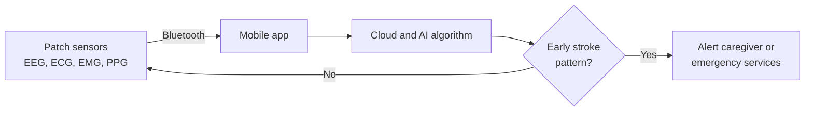

# NeuroPatch Wearable Stroke Monitor: Regulatory Strategy

[Back to portfolio](../README.md)

**Sohan Sai Jampala** | Purdue University, Medical Device Regulatory Affairs coursework | Spring 2025

A U.S. and EU regulatory strategy for NeuroPatch, a concept skin-worn patch that combines EEG, ECG, EMG and PPG sensing with an AI algorithm to flag early signs of stroke at home. The project covers classification, pathway choice, applicable standards and guidance, the evidence package (bench, software, biocompatibility, clinical), and a plan for the main regulatory roadblocks.

---

## Device concept

| Item | Description |
|---|---|
| Device | Flexible, adhesive wearable patch (about 60 x 45 x 3 mm) with EEG, ECG, EMG and PPG sensors and a microprocessor |
| Data flow | Patch streams data to a mobile app and cloud, where an AI algorithm looks for patterns suggesting ischemic or hemorrhagic stroke onset |
| Intended use | Continuous, non-invasive monitoring of neuro-cardiovascular signals in adults at risk of stroke, to detect early signs of a stroke event |
| Target population | Adults 50 and older with prior stroke or TIA, atrial fibrillation, or uncontrolled hypertension |
| Use environment | Home, with alerts to caregivers or emergency responders |
| Packaging | Sterile single-use blister pack; starter kit with patch, charger, setup guide and app access |

---

## Regulatory assessment

| | United States (FDA) | European Union |
|---|---|---|
| **Classification** | Class II, De Novo (neurological monitoring); no direct predicate for multi-sensor stroke detection | Likely Class IIa under EU MDR 2017/745 (active, non-invasive monitoring for early detection of a serious condition) |
| **Pathway** | De Novo request (FD&C Act 513(f)(2)), with Breakthrough Device Designation requested | CE marking with Notified Body review |
| **Early engagement** | Pre-Submission (Q-Sub) on classification, AI validation and the clinical plan | Early Notified Body consultation |
| **Key regulations** | 21 CFR 807, 21 CFR 820, 21 CFR Part 11 (if applicable) | MDR Annex II and III technical documentation, Article 61 clinical evaluation, Annex XIV Part B PMCF |
| **Other requirements** | FDA premarket cybersecurity expectations; HIPAA-aligned data handling | GDPR, EUDAMED registration, UDI, multi-language IFU |

### Standards and guidance mapped to the evidence plan

| Area | Standard or guidance | Evidence planned |
|---|---|---|
| Risk management | ISO 14971:2019 | Risk management file covering hardware, software, AI and use errors |
| Electrical safety and EMC | IEC 60601-1, IEC 60601-1-2 (EN versions for EU) | Electrical safety and EMC testing |
| ECG performance | IEC 60601-2-47 | ECG channel performance testing |
| Biocompatibility | ISO 10993 series | Cytotoxicity, sensitization, irritation for the skin-contact patch |
| Software | IEC 62304; FDA guidance on software in premarket submissions (2021) and clinical decision support (2022) | Software lifecycle documentation and verification and validation |
| Usability | IEC 62366; FDA home-use design guidance (2019) | Human factors and usability engineering for home users |
| Data security | ISO/IEC 27001 | Cloud and mobile security controls |
| Wireless and battery | Device-specific testing | Bluetooth reliability and battery safety tests |

### Clinical evidence

| | Plan |
|---|---|
| Study design | Prospective, multi-center study, 200 high-risk patients, 30 days of continuous wear |
| Primary endpoints | Sensitivity and specificity of early stroke detection; time to alert versus clinical onset |
| Secondary endpoints | Usability, adherence, alert reliability, response time |
| EU | Clinical performance study under MDR Article 61; U.S. feasibility data may support the EU file if use is comparable; PMCF plan with safety, performance and usability endpoints |

---

## Roadblocks and mitigation

| Roadblock | Plan |
|---|---|
| Multiple sensors plus AI create classification uncertainty | Use the Q-Sub to agree on classification and evidence early |
| No direct predicate device | Justify De Novo with the novel intended use and a clear risk mitigation story |
| AI algorithm raises software and SaMD questions | Algorithm validation plan aligned with FDA software and clinical decision support guidance |
| No predicate for stroke-monitoring wearables in the EU | Strong justification dossier with performance comparison to related devices |
| Speed to market | Request Breakthrough Device Designation for prioritized review |

## Market landscape

| Product | What it does | How NeuroPatch differs |
|---|---|---|
| Zio patch (iRhythm) | Long-term ECG for arrhythmia | NeuroPatch adds EEG, EMG and PPG and targets stroke onset |
| Ceribell EEG headband | Emergency EEG monitoring | NeuroPatch is built for continuous home wear |
| Biobeat | PPG-based vital sign monitoring with AI | NeuroPatch combines neuro and cardiac signals for stroke detection |

---

**Skills shown:** device classification, De Novo and EU MDR pathway planning, standards mapping (ISO 14971, IEC 60601, IEC 62304, IEC 62366, ISO 10993), clinical evidence planning, regulatory risk identification.
