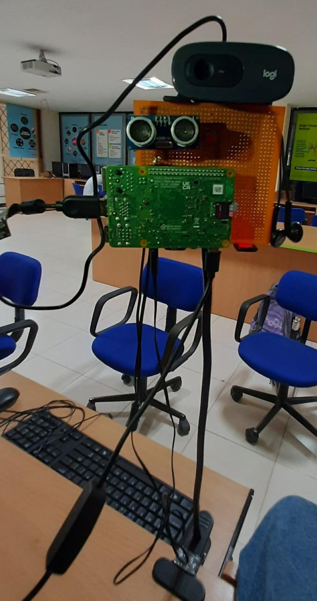
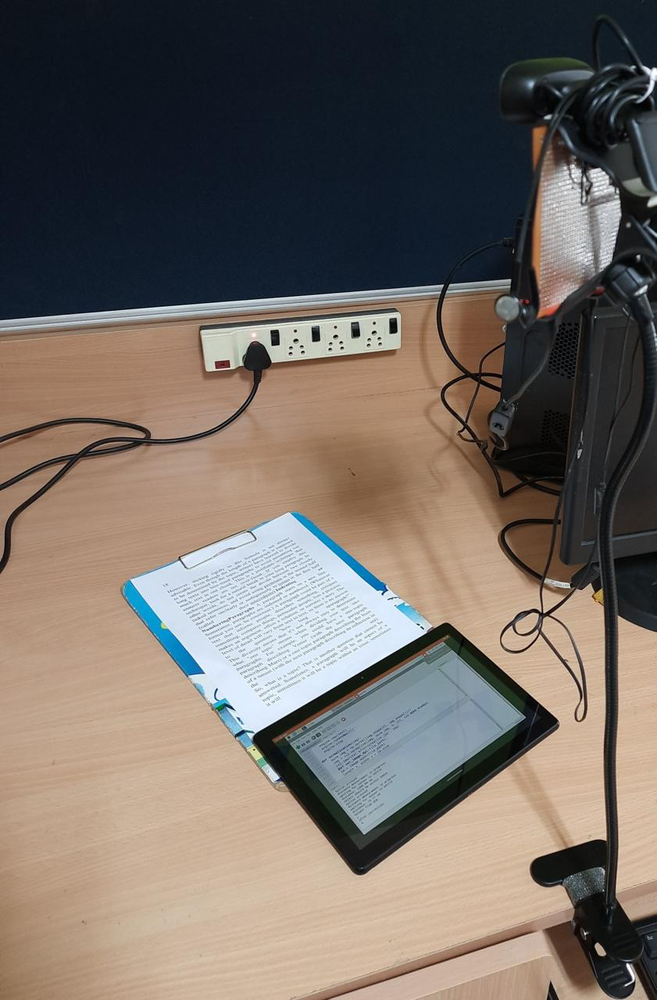
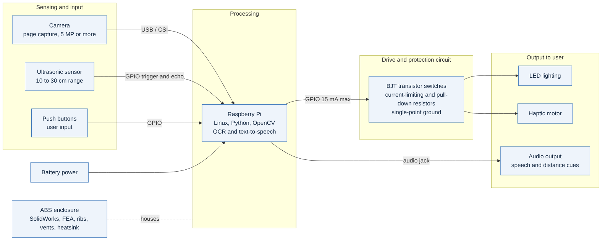

# Portable Assistive Reading Device: Systems Engineering Summary

[Back to portfolio](../README.md)

**Sohan Sai Jampala** | Project lead, design controls and verification | PSG College of Technology, Coimbatore, India | Full year 2022

A handheld device that helps visually impaired users read printed text. A camera captures the page, a Raspberry Pi runs image preprocessing and OCR in Python and OpenCV, and the text is read aloud. Ultrasonic sensing gives audio cues to hold the page at the right distance.

The project followed a design-controls approach (21 CFR 820.30, ISO 13485, ISO 14971). User needs were traced to design inputs, outputs and verification tests, and risk controls were tied to test results.

---

## Key results

| Metric | Result | Requirement |
|---|---|---|
| OCR accuracy (after 3-factor Minitab DOE) | 97.4% | Optimal setup: 18 cm distance, 100% LED drive, adaptive thresholding |
| Leakage current to enclosure | 0.00 µA | Under 10.0 µA |
| Enclosure surface temperature at max CPU load | Below 35.5 °C | Under 41.0 °C |
| 1 m drop test on 6 faces | Zero cracks or bracket fractures | No structural damage |
| Peak enclosure stress (FEA, 50 N grip) | 4.2 MPa (ABS yield 40 MPa, safety factor above 9) | Below yield |
| DFMEA total risk (5 failure modes) | RPN 360 to 81 (77.5% reduction) | All risks reduced to acceptable |

---

## Prototype iterations

| Early bench prototype | Sensor and compute mount |
|---|---|
|  |  |
| First test model: USB webcam on a gooseneck arm over a printed page, with code running on an attached display. | Ultrasonic distance sensor and Raspberry Pi mounted on a perfboard bracket, with wired earphones for audio output. |

These early test models proved the capture, OCR and audio chain on the bench. Later iterations moved to a Raspberry Pi camera module, a soldered drive circuit, and a SolidWorks-designed ABS enclosure.

---

## System architecture

| Subsystem | Function | Key design decision |
|---|---|---|
| Camera | Page capture | 5 MP or higher resolution; LED lighting for even contrast |
| Ultrasonic sensor | Measures distance to page | Median filter over 5 pings before triggering capture |
| Raspberry Pi | OCR, text-to-speech, control logic | Python and OpenCV; heatsink and vents for thermal margin |
| Drive and protection circuit | Switches LED and haptic loads | BJT switches isolate GPIO pins; pull-down resistors stop floating inputs |
| Audio and haptic output | Speech and positioning cues | "Move closer / further" audio prompts |
| Enclosure | Houses and protects electronics | ABS, cross-ribs at brackets, rounded internal corners |

### Interfaces

| ID | From | To | Type | Requirement |
|---|---|---|---|---|
| IF-01 | Ultrasonic sensor | Raspberry Pi | GPIO trigger and echo | Pull-down on echo line; filtered reading |
| IF-02 | Camera | Raspberry Pi | USB (bench) / CSI (later builds) | Capture only after valid distance reading |
| IF-03 | Raspberry Pi | Drive circuit | GPIO control | 15 mA or less per line |
| IF-04 | Drive circuit | LED, haptic motor | Switched power | Current-limited through series resistors |
| IF-05 | Raspberry Pi | Audio output | Audio jack | Speech and distance cues |
| IF-06 | Electronics | Enclosure | Mechanical and electrical | Single-point ground, heat-shrink insulation, no leakage to touch points |

---

## Requirements traceability

| User need | Design input | Design output | Verification | Validation protocol |
|---|---|---|---|---|
| UN-01: Detect reading distance and align capture | DI-01: Range 10 to 30 cm, 5 mm error or less | GPIO ultrasonic module with filtering software | VER-ELEC-01: Distance check on a graduated rail fixture (5 to 50 cm) | VAL-USER-01: User positioning trial |
| UN-02: Capture sharp text images without lighting problems | DI-02: Camera 5 MP or more; transistor-switched LED lighting | Camera module with LED lighting ring | VER-OPT-01: Image contrast and resolution benchmark | VAL-USER-02: Full-page reading conversion |
| UN-03: Prevent power fluctuations, leakage and component damage | DI-03: GPIO draw 15 mA or less; zero leakage to chassis | Soldered BJT switch board, current-limiting resistors, decoupling capacitors | VER-ELEC-02: Leakage and noise profiling (0.00 µA measured) | VAL-ELEC-01: Continuous operation bench test |
| UN-04: Withstand daily handling without damage | DI-04: Stress below yield; survive 1 m drop | SolidWorks ABS enclosure with ribs and bracket mounts | VER-MECH-01: FEA plus 1 m drop on 6 faces | VAL-USER-03: Hand-held durability evaluation |

---

## Risk management (ISO 14971 DFMEA)

| Failure mode | Effect | RPN before | Control | RPN after |
|---|---|---|---|---|
| Switching noise on GPIO lines | False camera triggers | 96 | Pull-down resistors and transistor isolation | 18 |
| Leakage to housing seams | User exposure, battery drain | 84 | Heat-shrink insulation, single-point ground | 14 |
| CPU overheating in enclosure | Freeze, hot surface | 72 | Heatsink, thermal pads, vent slots | 18 |
| Stress at mounting brackets | Cracks on drop | 60 | Cross-ribs and rounded corners | 15 |
| Ultrasonic echo misread | Out-of-focus capture | 48 | 5-ping median filter | 16 |
| **Total** | | **360** | | **81** |

### Root cause example: false camera triggers
During testing the camera fired intermittently with no user input. The cause was floating GPIO inputs plus switching noise from breadboard wiring. The fix was soldered pull-down resistors and transistor isolation. The same test conditions were then rerun with no false triggers, and the DFMEA item was updated (RPN 96 to 18).

---

## Design transfer
Released a bill of materials, assembly work instructions, and SOPs (soldering, resistor and transistor mounting, thermal pads, final assembly) so each unit was built and tested the same way. The design history file held the user needs, architecture, CAD and drawings, risk file, V&V protocols and reports, and the DOE report.

## Tools
Raspberry Pi, Python, OpenCV, SolidWorks (CAD, drawings, FEA), Minitab (DOE), multimeter, thermocouples, custom test fixtures.
