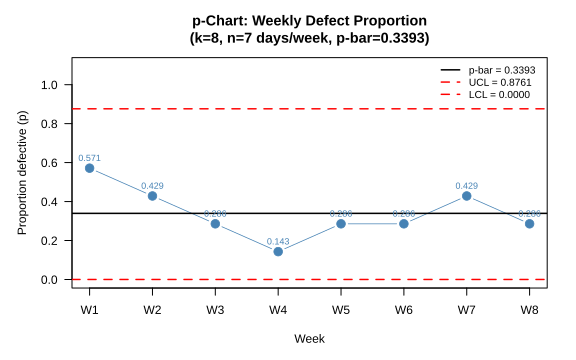
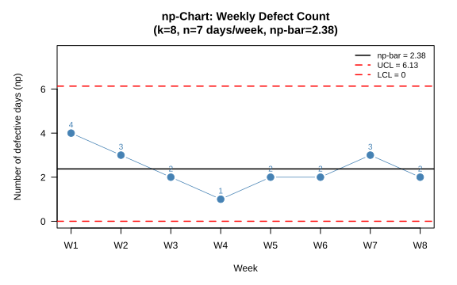
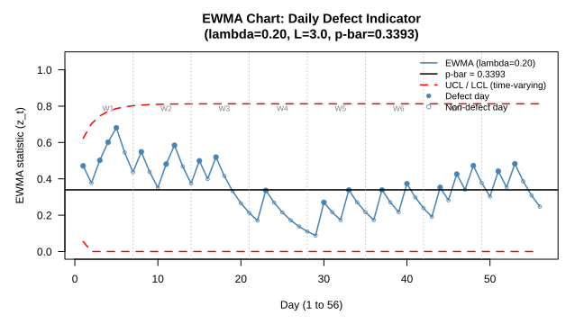
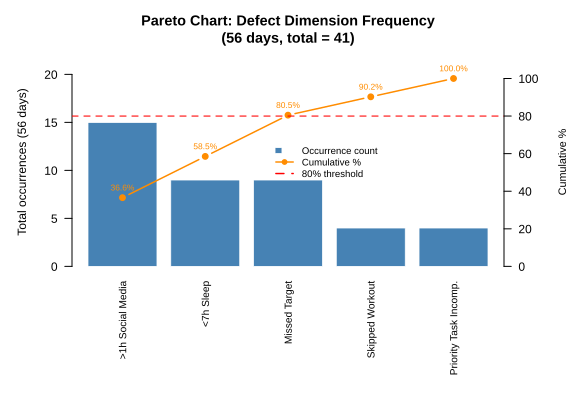

# Statistical Process Control Study: DMAIC and Root Cause Analysis

[Back to portfolio](../README.md)

**Sohan Sai Jampala** | Purdue University, IE530 Statistical Quality Control | Spring 2026

An 8-week SPC study that treats daily productivity as a process with a binary defect output. It uses p and np control charts, an EWMA chart, Pareto analysis, and a binomial model, structured with DMAIC. All charts and numbers in this README are reproduced by the R script in this folder.

---

## Results at a glance

| Question | Answer |
|---|---|
| Is the process stable? | **Yes.** All 8 weekly points sit inside 3-sigma limits on the p and np charts, and the EWMA shows no signals over 56 days. |
| Is it capable? | **No.** p-bar = 0.3393 (19 of 56 days defective), about 1 day in 3. |
| What drives the defects? | **3 causes = 80.5% of 41 failures:** social media overuse (36.6%), short sleep (22.0%), missed targets (22.0%). |
| What is the weekly risk? | E[X] = 2.375 defective days per week; P(4 or more) = 18.3%; P(zero-defect week) = 5.5%. |
| Improvement target | p at or below 0.20, which would cut P(4 or more) to 3.3% and raise P(zero) to 21%. |

---

## DMAIC structure

| Phase | What was done |
|---|---|
| **Define** | A day is defective if any of 5 conditions occurs: under 7 h sleep, missed target, over 1 h social media, skipped workout, priority task incomplete. |
| **Measure** | 56 days of binary data from an evening checklist (8 weekly subgroups of n = 7). |
| **Analyze** | p chart, np chart, EWMA (lambda = 0.2, L = 3), Pareto, Binomial(7, p-bar). |
| **Improve** | Countermeasures aimed at the vital few causes (below). |
| **Control** | Fixed control limits plus a weekly EWMA review to catch drift early. |

> **Data note:** the daily defect flag was recorded each evening as a separate overall judgement, so on 8 of the 56 days it differs from a strict "any dimension failed" rule (for example, one day is flagged with no single dimension marked, and some days with a marked dimension are not flagged). All charts and results here use the recorded flag, exactly as in the submitted report. Applying the strict rule instead gives 25 defective days (p-bar = 0.446). The process would still be in control, but further from the 0.20 target. The Pareto counts do not depend on the flag.

---

## Control charts

### p chart (weekly proportion defective)
p-bar = 0.3393, sigma = 0.1790, UCL = 0.8761, LCL = 0. Week 1 was highest (0.571) and Week 4 lowest (0.143).



### np chart (weekly count defective)
np-bar = 2.375, UCL = 6.133, LCL = 0. Weekly counts ranged from 1 to 4.



### EWMA chart (daily, lambda = 0.2, L = 3)
Picks up gradual shifts the weekly charts can miss. It peaked near 0.68 on Day 5, dropped to about 0.09 in the clean stretch around Days 22 to 29, and rose slightly in Weeks 7 and 8, all within limits (steady-state UCL = 0.8128).



---

## Root cause analysis

### Pareto

| Defect dimension | Count | Share | Cumulative |
|---|---|---|---|
| Over 1 h social media | 15 | 36.6% | 36.6% |
| Under 7 h sleep | 9 | 22.0% | 58.5% |
| Missed target | 9 | 22.0% | 80.5% |
| Skipped workout | 4 | 9.8% | 90.2% |
| Priority task incomplete | 4 | 9.8% | 100.0% |



### Ishikawa (cause and effect) summary
- **Environment:** phone within reach during work; no distraction-free workspace.
- **Methods:** no daily planning ritual; no end-of-day review.
- **People:** reactive, notification-driven habits; late-night phone use links social media (#1) to short sleep (#2).

---

## Improvement and control plan

| Countermeasure | Targets |
|---|---|
| Phone-free, time-boxed work blocks with a focus app | Social media overuse (#1) |
| Fixed sleep and wake times; phone off 30 minutes before bed | Short sleep (#2), and social media at night |
| 10-minute morning planning with specific daily targets | Missed targets (#3) |
| Weekly EWMA review every Sunday | Drift caught before it becomes a signal |

**Next steps:** collect a Phase II 8-week dataset after the countermeasures, test the improvement with a two-proportion z-test, and consider n = 14 days per subgroup for tighter limits.

---

## How to reproduce

```bash
cd spc-dmaic-study
Rscript R/spc_charts.R
```

Requires base R. If the `svglite` package is installed it is used for smaller SVG files; otherwise base `svg()` is used. Console output is saved in [`results/console_output.txt`](results/console_output.txt).

## Files

| Path | Contents |
|---|---|
| `data/IE530_Project_data.csv` | 56-day binary dataset (5 defect dimensions plus the daily defect flag) |
| `R/spc_charts.R` | p, np, Pareto and EWMA charts plus the binomial model |
| `figures/` | Chart outputs (SVG) |
| `results/console_output.txt` | Control limits, Pareto counts and binomial results |

**Tools:** R, SPC (p, np, EWMA), Pareto, Ishikawa, binomial modeling, DMAIC. Reference: Montgomery, *Introduction to Statistical Quality Control*, 8th ed.
